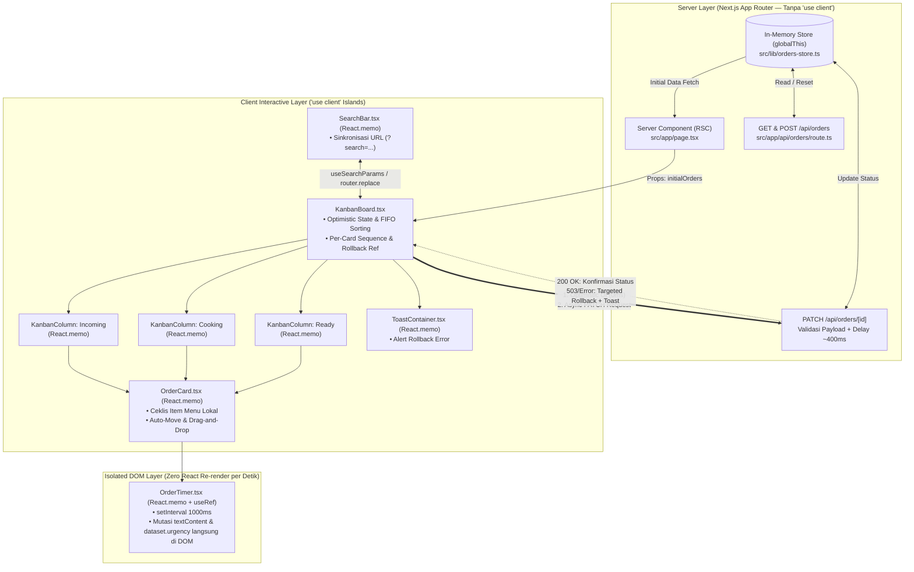
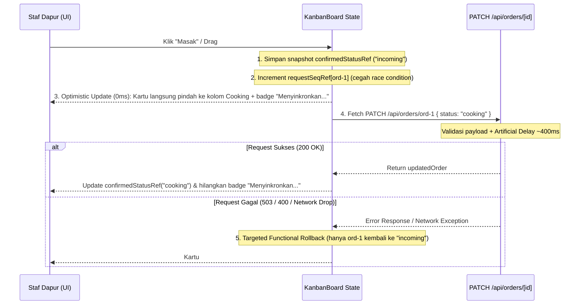

# Real-Time Kitchen Display System (KDS) — Mie Gacoan (PT Pesta Pora Abadi)

> **Live Demo / Preview:** [**https://ppakds.farstywan.my.id/**](https://ppakds.farstywan.my.id/)

Purwarupa **Real-Time Kitchen Display System (KDS)** berbasis **Next.js (App Router)** dan **TypeScript** untuk memantau serta mengelola antrean dapur berkecepatan tinggi (*Incoming*, *Cooking*, dan *Ready*).

Proyek ini dirancang khusus untuk menjawab tantangan teknis di lapangan pada operasional outlet F&B dengan *order rate* tinggi:
1. **Zero Timer Re-render Propagation** — Durasi tunggu pesanan berdetak setiap detik tanpa memicu *re-render* ke *parent board* maupun kartu pesanan lainnya.
2. **Optimistic State Update & Targeted Rollback** — Transisi status kartu berlangsung instan (`0ms` di layar) meski *request* `PATCH` memiliki *artificial network delay* (`~400ms`), disertai mekanisme *rollback* presisi dan *toast alert* apabila jaringan gagal.
3. **Presisi Server vs Client Boundary** — Halaman utama (`src/app/page.tsx`) tetap menjadi **React Server Component (RSC)** murni, sementara direktif `'use client'` hanya ditempatkan pada *interactive leaf/island components*.
4. **URL State Synchronization (`?search=...`)** — Pencarian nomor pesanan (`#ORD-101`), nomor meja (`Meja 08`), maupun nama menu tersinkronisasi langsung dengan *query string* URL dan aman saat halaman di-*refresh*.

---

## Panduan Menjalankan Aplikasi Secara Lokal

### Prasyarat
- **Node.js** `>= 18.18.0` (direkomendasikan v20 atau v22 LTS)
- **npm**

### Langkah Instalasi & Menjalankan Server Development
```bash
# 1. Clone repositori
git clone https://github.com/Farstywn/PPARealTimeKitchenDisplaySystem.git
cd PPARealTimeKitchenDisplaySystem

# 2. Install dependensi
npm install

# 3. Jalankan development server
npm run dev
```
Buka **`http://localhost:3000`** di browser untuk melihat dashboard KDS.

### Menjalankan Build Produksi
```bash
npm run build
npm run start
```

---

## Struktur Direktori & Arsitektur Komponen

```text
src/
├── app/
│   ├── api/
│   │   └── orders/
│   │       ├── route.ts            # GET /api/orders & POST reset store
│   │       └── [id]/
│   │           └── route.ts        # PATCH /api/orders/[id] (validasi + delay 400ms)
│   ├── globals.css                 # Styling global & selector atribut [data-urgency]
│   ├── layout.tsx                  # Root Server Layout
│   └── page.tsx                    # Server Component (RSC) - Initial Data Fetch & Header
├── components/
│   ├── kds/
│   │   ├── KanbanBoard.tsx         # 'use client' - Optimistic state, in-flight & rollback
│   │   ├── KanbanColumn.tsx        # 'use client' (React.memo) - Kolom Incoming/Cooking/Ready
│   │   ├── OrderCard.tsx           # 'use client' (React.memo) - Kartu pesanan & drag/click
│   │   ├── OrderTimer.tsx          # 'use client' (React.memo + useRef) - Isolated Live Timer
│   │   └── SearchBar.tsx           # 'use client' - Sinkronisasi URL (?search=...)
│   └── ui/
│       └── ToastContainer.tsx      # 'use client' - Notifikasi error rollback
├── lib/
│   └── orders-store.ts             # Singleton in-memory store (globalThis)
└── types/
    └── order.ts                    # Definisi tipe data & helper validasi status
```

---

## Flowchart Global Arsitektur & Alur Aplikasi

### A. Flowchart Arsitektur Sistem (Server vs Client Boundary & Render Isolation)
Diagram berikut memvisualisasikan pemisahan antara **Server Layer (RSC & Route Handlers)**, **Client Interactive Layer**, dan **Isolated DOM Layer** agar detak timer setiap detik tidak pernah memicu *re-render* ke pohon komponen React:



### B. Flowchart Alur Operasional Pesanan Dapur (End-to-End KDS Workflow)
Diagram berikut menggambarkan siklus hidup pesanan dari saat pesanan masuk hingga siap diantar ke meja pelanggan:

```mermaid
flowchart LR
    Start(["Pesanan Masuk\n(POS / Kasir)"]) --> Incoming["Kolom INCOMING\n(Pesanan Baru Masuk)\nUrutan Prioritas FIFO"]

    Incoming -->|"Klik 'Masak' /\nDrag ke Cooking /\nCeklis Semua Menu"| Optimistic1{"Optimistic Update\n(0ms Instan di Layar)"}

    Optimistic1 -->|PATCH /api/orders/id| CheckAPI1{"Response Server\n(~400ms)"}
    CheckAPI1 -->|"Gagal (Network Drop / 503)"| Rollback1["Rollback ke INCOMING\n+ Tampilkan Toast Error"]
    Rollback1 --> Incoming

    CheckAPI1 -->|"Sukses (200 OK)"| Cooking["Kolom COOKING\n(Sedang Dimasak di Wok / Fryer)\nUrutan Prioritas FIFO"]

    Cooking -->|"Staf Ceklis Item Menu\nSatu per Satu"| CheckAll{"Semua Item Menu\nSudah Tercentang?"}
    CheckAll -->|"Belum Semua"| Cooking
    CheckAll -->|"Ya (Auto-Move) /\nKlik 'Siap Saji' /\nDrag ke Ready"| Optimistic2{"Optimistic Update\n(0ms Instan di Layar)"}

    Optimistic2 -->|PATCH /api/orders/id| CheckAPI2{"Response Server\n(~400ms)"}
    CheckAPI2 -->|"Gagal (Network Drop / 503)"| Rollback2["Rollback ke COOKING\n+ Tampilkan Toast Error"]
    Rollback2 --> Cooking

    CheckAPI2 -->|"Sukses (200 OK)"| Ready["Kolom READY\n(Siap Diantar ke Meja / Pickup)\nSemua Item Tercentang Hijau"]
    Ready --> End(["Diantar Staf Runner\nke Meja Pelanggan"])
```



---

## Panduan Penggunaan Aplikasi (User Manual Operasional)

Panduan singkat ini menjelaskan cara menggunakan seluruh fitur yang tersedia pada layar **Kitchen Display System (KDS)**:

### 1. Memahami Papan Antrean 3 Kolom & Urutan Prioritas (FIFO)
Layar utama terbagi menjadi 3 kolom status operasional dapur:
| Kolom | Subjudul Operasional | Fungsi Utama |
| :--- | :--- | :--- |
| **Incoming** | *Pesanan Baru Masuk* | Menampilkan daftar pesanan baru dari kasir/POS yang menunggu mulai dimasak. |
| **Cooking** | *Sedang Dimasak di Wok / Fryer* | Menampilkan pesanan yang sedang dikerjakan oleh kru dapur (*wok*, *fryer*, minuman). |
| **Ready** | *Siap Diantar ke Meja / Pickup* | Menampilkan pesanan yang seluruh item menunya telah selesai dan siap dibawa *runner* ke meja. |

> **Prinsip Urutan FIFO (*First-In, First-Out*):**  
> Di setiap kolom, kartu pesanan **diurutkan otomatis berdasarkan waktu tunggu terlama di posisi paling atas**. Contoh: pesanan dengan durasi `11m 20s lalu` akan selalu berada di atas pesanan `7m 57s lalu` agar staf dapur langsung memprioritaskan pesanan yang sudah menunggu lebih lama.

---

### 2. Membaca Indikator Durasi Tunggu (SLA Live Timer)
Setiap kartu pesanan memiliki *Live Timer* di pojok kanan atas yang berubah warna secara otomatis sesuai durasi tunggu (*Service Level Agreement* dapur):
- **Biru Cyan (`< 5m Normal`)**: Pesanan baru masuk dalam batas waktu normal.
- **Kuning Amber (`5–10m Pantau`)**: Pesanan sudah menunggu cukup lama dan perlu dipantau.
- **Merah/Magenta Berkedip (`> 10m Prioritas`)**: Pesanan melewati batas 10 menit dan wajib segera diselesaikan.
- **Hijau Emerald (Kolom `Ready`)**: Pesanan telah selesai dimasak dan siap diantar.

---

### 3. Ceklis Item Menu & Fitur Pindah Otomatis (*Auto-Move*)
Untuk memudahkan kru dapur yang menyiapkan beberapa menu dalam satu meja:
1. **Klik pada baris nama menu** (misalnya klik `Mie Gacoan Lv 6` atau `Siomay` pada `#ORD-104 Meja 05`) untuk menandai menu tersebut sudah selesai dibuat.
2. Indikator lingkaran di sebelah kiri menu akan berubah menjadi **centang hijau** dan bagian bawah kartu menampilkan progres penyelesaian (contoh: `2/4 selesai • 9 porsi`).
3. **Transisi Otomatis (*Auto-Move*)**: Begitu **seluruh item menu** di dalam satu kartu selesai dicentang, kartu tersebut **otomatis berpindah ke kolom berikutnya** tanpa perlu menekan tombol pindah status lagi.
4. Pada kolom **Ready**, seluruh daftar menu ditampilkan dengan ikon centang hijau **tanpa garis coret (*strikethrough*)** agar staf *runner* tetap dapat membaca daftar menu dan jumlah porsi dengan jelas saat *quality check* pengantaran ke meja.

---

### 4. Memindahkan Status Kartu Secara Manual (Tombol & *Drag-and-Drop*)
Selain menggunakan ceklis item otomatis, staf dapur dapat memindahkan kartu dengan dua cara:
- **Melalui Tombol Aksi di Kanan Bawah Kartu**:
  - Klik **`Masak`** pada kolom *Incoming* untuk memindahkan kartu ke *Cooking*.
  - Klik **`Siap Saji`** pada kolom *Cooking* untuk memindahkan kartu ke *Ready*.
  - Klik **`Kembali`** jika ingin mengembalikan kartu ke tahap sebelumnya.
- **Melalui *Drag-and-Drop***:
  - Klik, tahan, dan geser (*drag*) kartu pesanan langsung ke area kolom tujuan (*Incoming*, *Cooking*, atau *Ready*).

---

### 5. Fitur Pencarian Cepat & Sinkronisasi URL (`?search=...`)
- Ketik kata kunci pada kotak pencarian di kiri atas (atau tekan tombol **`/`** pada keyboard untuk langsung fokus ke kolom pencarian).
- Anda dapat mencari berdasarkan:
  - **Nomor Order** (contoh: `101` atau `#ORD-104`)
  - **Nomor Meja** (contoh: `Meja 08` atau `05`)
  - **Nama Menu** (contoh: `Hompimpa`, `Udang Keju`, `Sluku Bathok`)
- Kata kunci pencarian langsung tersinkronisasi ke URL browser (`?search=Meja+08`). Jika halaman di-*refresh* (`F5`), hasil filter pencarian tidak akan hilang. Klik **`Reset`** di dalam kotak pencarian untuk menampilkan seluruh pesanan kembali.

---

### 6. Menguji Ketahanan Jaringan (*Simulasi Gagal API*) & *Reset Antrean*
Di pojok kanan atas papan kontrol terdapat dua tombol utilitas untuk keperluan pengujian teknis:
1. **`Simulasi Gagal API: Nonaktif / Aktif`**:
   - Klik tombol ini hingga berubah menjadi warna merah muda (**`Simulasi Gagal API: Aktif`**).
   - Coba pindahkan salah satu kartu pesanan. Kartu akan **berpindah seketika (`0ms`)** ke kolom tujuan (*Optimistic UI*), lalu setelah jeda simulasi jaringan `~400ms`, server mengembalikan error `503` dan kartu **otomatis kembali (*rollback*)** ke kolom semula disertai notifikasi **Toast Error** di pojok kanan bawah.
2. **`Reset Antrean`**:
   - Klik tombol ini kapan saja untuk mengembalikan seluruh data pesanan dan durasi waktu ke 8 pesanan contoh awal.

---

## Catatan Teknis Utama (Engineering Explanations)

### 1. Isolasi Komponen Live Timer Tanpa Memicu Re-render (`OrderTimer.tsx`)

#### Masalah Umum di Lapangan
Jika durasi tunggu disimpan menggunakan `useState` di level `KanbanBoard` atau `OrderCard` dengan `setInterval(..., 1000)`, maka setiap detik seluruh pohon komponen (`KanbanBoard` → 3 `KanbanColumn` → 8+ `OrderCard` → puluhan item menu) akan mengalami siklus *re-render* berulang. Pada outlet sibuk dengan puluhan pesanan aktif, hal ini menyebabkan UI *lag*, *flickering*, dan *layout thrashing*.

#### Solusi Arsitektur yang Diterapkan
Kami menerapkan **dua lapis isolasi** pada [`src/components/kds/OrderTimer.tsx`](src/components/kds/OrderTimer.tsx):

1. **Isolasi Siklus Render via `useRef` & Manipulasi `textContent` Langsung (Zero React Re-render per Detik)**
   - Alih-alih memanggil `setState` setiap `1000ms` (yang tetap memaksa React menjalankan *Virtual DOM diffing* setiap detik), komponen `OrderTimer` memegang referensi langsung ke *leaf DOM node* melalui `textRef = useRef<HTMLSpanElement>(null)` dan `badgeRef = useRef<HTMLDivElement>(null)`.
   - Di dalam `useEffect`, `setInterval` menghitung selisih waktu terhadap `Date.parse(createdAt)` lalu memperbarui `textRef.current.textContent` (contoh: `"5m 12s lalu"`) serta atribut `badgeRef.current.dataset.urgency` (`"normal"` | `"warning"` | `"critical"` | `"completed"`) secara langsung di DOM.
   - Styling warna indikator SLA dikendalikan oleh selector atribut CSS murni (`.kds-timer-badge[data-urgency="..."]` di `globals.css`) dan font angka menggunakan `tabular-nums` (`font-variant-numeric: tabular-nums`) sehingga perubahan lebar karakter angka (`1` ke `8`) tidak pernah memicu *browser layout reflow / layout thrashing*.

2. **Isolasi Batas Komponen via `React.memo`**
   - `OrderTimer` dibungkus `React.memo` dengan komparator `(prev, next) => prev.createdAt === next.createdAt && prev.status === next.status`.
   - `OrderCard` juga dibungkus `React.memo` dengan referensi prop fungsi (`onStatusChange`, `onDragStartOrder`, `onDragEndOrder`) yang dijaga tetap stabil menggunakan `useCallback` + `useRef`.

#### Catatan Verifikasi dari React DevTools Profiler
Cara memverifikasi secara langsung di browser:
1. Buka aplikasi di Chrome (`http://localhost:3000` atau `https://ppakds.farstywan.my.id`) dan buka **React DevTools** → tab **Profiler**.
2. Klik ikon **Settings (⚙️)** pada Profiler → centang **"Record why each component rendered while profiling"** dan **"Highlight updates when components render"**.
3. Klik tombol **Record (🔵)** dan biarkan aplikasi berjalan selama **10–15 detik** sambil mengamati seluruh timer kartu pesanan berdetak (`5m 12s lalu` → `5m 13s lalu` → dst.).
4. Hentikan rekaman Profiler:
   - **Hasil ketika tidak ada interaksi klik**: **0 commit React tercatat** selama timer berdetak setiap detik! Seluruh 8 timer di layar ter-update secara *real-time* di DOM tanpa satu pun siklus *re-render* pada `KanbanBoard`, `KanbanColumn`, `OrderCard`, maupun `OrderTimer`.
   - **Hasil ketika 1 kartu dipindah status**: Hanya kartu yang bersangkutan (`OrderCard`) dan kolom terkait yang di-*render*, sedangkan **7 `OrderCard` lainnya berstatus *Did not render*** karena terjaga oleh `React.memo` dan referensi objek yang tidak berubah.

---

### 2. Pendekatan Optimistic State Update & Rollback saat Request Network Gagal (`KanbanBoard.tsx`)

#### Alur Kerja Optimistic Update & Rollback
Implementasi pada [`src/components/kds/KanbanBoard.tsx`](src/components/kds/KanbanBoard.tsx) dirancang agar staf dapur tidak pernah tertahan oleh latensi jaringan (`~400ms`):



#### Mengapa Menggunakan *Targeted Functional Rollback* + *Request Sequence Guard*?
1. **Tidak Menimpa Kartu Lain yang Sedang Berjalan Bersamaan (*Concurrent Safe*)**:
   - Jika staf dapur memindahkan `#ORD-101` lalu `100ms` kemudian memindahkan `#ORD-102`, menyimpan *snapshot* seluruh array `orders` secara naif akan berbahaya karena *rollback* pada `#ORD-101` bisa ikut membatalkan perubahan `#ORD-102`.
   - Solusi kami menyimpan status terkonfirmasi per-ID di `confirmedStatusRef` (`Map<string, OrderStatus>`) dan melakukan *rollback* secara spesifik hanya pada ID pesanan yang gagal menggunakan *functional state update*:
     ```ts
     setOrders((prevOrders) =>
       prevOrders.map((item) =>
         item.id === orderId
           ? { ...item, status: previousConfirmedStatus }
           : item
       )
     );
     ```
2. **Pencegahan *Race Condition* (`requestSeqRef`)**:
   - Setiap kali sebuah kartu dipindahkan, nomor urut *request* untuk `orderId` tersebut di-increment (`requestSeqRef.current.set(orderId, currentSeq)`). Jika ada respons lama yang baru selesai setelah aksi yang lebih baru, respons usang (*stale*) tersebut diabaikan.

#### Cara Menguji Mekanisme Rollback Secara Langsung
1. Di bagian atas papan KDS, klik tombol **"Simulasi Gagal API: Nonaktif"** hingga berubah menjadi **"Simulasi Gagal API: Aktif"**.
2. Klik tombol **"Masak"** pada salah satu kartu di kolom *Incoming* (atau *drag-and-drop* kartu ke kolom lain).
3. Amati hasilnya:
   - Kartu **langsung berpindah kolom seketika** (`0ms`) dengan indikator `Menyinkronkan...`.
   - Setelah simulasi delay `~400ms`, endpoint `PATCH /api/orders/[id]` mengembalikan `503 Service Unavailable`.
   - Kartu **otomatis kembali (*rollback*)** ke kolom asalnya dan muncul **Toast Alert Error** di pojok kanan bawah layar beserta detail transisi yang di-*rollback*.

---

## Dokumentasi Endpoint API

### 1. `GET /api/orders`
Mengambil daftar pesanan dari *in-memory store*.
```bash
curl http://localhost:3000/api/orders
```

### 2. `PATCH /api/orders/[id]`
Mengubah status pesanan dengan validasi *payload* ketat dan *artificial delay* `400ms`.
- **Body Valid**: `{ "status": "incoming" | "cooking" | "ready", "simulateError"?: boolean }`
- **Response `200 OK`**: Mengembalikan objek `Order` terbaru.
- **Response `400 Bad Request`**: Jika JSON tidak valid atau nilai `status` di luar `incoming | cooking | ready`.
- **Response `404 Not Found`**: Jika `id` pesanan tidak ditemukan.
- **Response `503 Service Unavailable`**: Jika mode simulasi gagal diaktifkan (`simulateError: true`).
